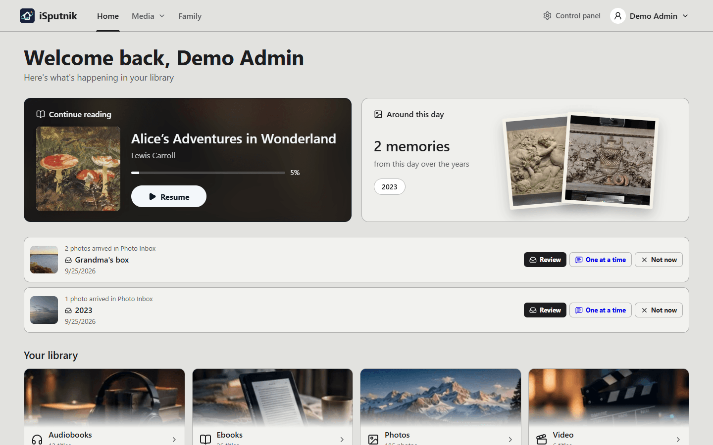
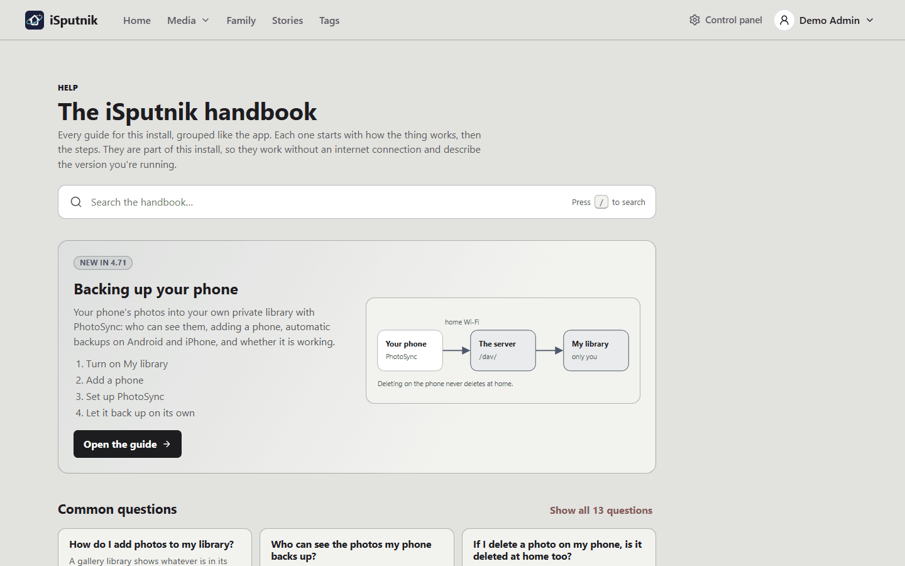
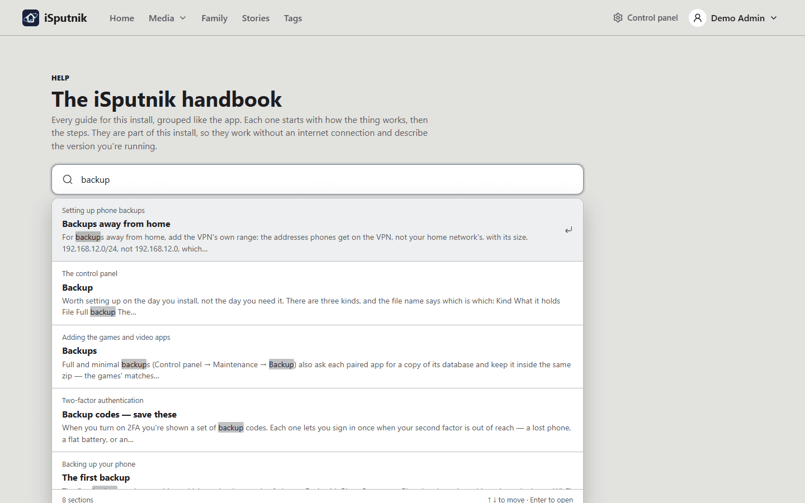
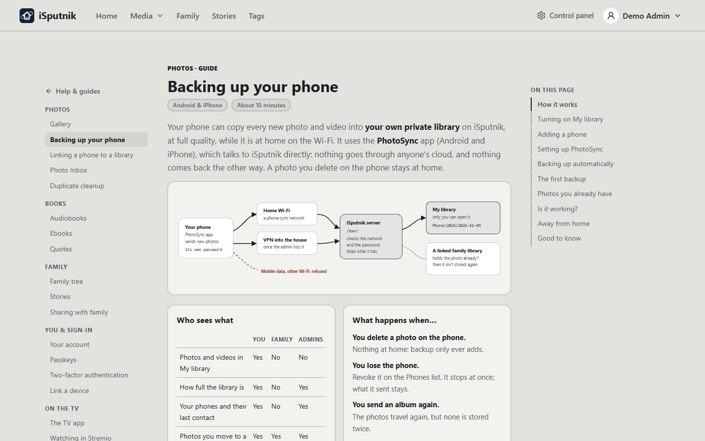

# User guides

Friendly, task-focused guides for people using and running isputnik.home.

> These files are **shipped inside the app**. The web build copies this folder to
> `apps/web/public/guides/` and renders it at `/help/<name>`, so a server with no
> internet still has its documentation and always shows the version it's running.
> Editing a guide here changes what the app shows on the next build — and
> `npm run check:ui` fails if a guide isn't listed on the in-app Help page.
>
> Two things follow from that: link between guides with a plain relative name
> (`[Storage](storage.md)`), which is rewritten to an in-app route, and keep images
> under `images/`, which is rewritten to `/guides/images/`.
>
> A new guide also needs an entry (and a shelf) in
> `apps/web/src/features/help/catalog.ts`, which is what the Help page and
> `/help/guides` list. [faq.md](faq.md) holds the Help page's frequently asked
> questions: link each answer to a guide section, and headings renamed here must
> keep those links working — `check:ui` checks them. Headings are also what the
> Help page's search results open at, so name sections for what a reader would type.

## Writing a guide

The app reads a guide as a page of a handbook: the shelves on the left, the guide in
the middle, **On this page** on the right. Plain markdown works as it always has; a
few extra shapes make a guide read better, and all of them still show sensibly on
GitHub.

- **Open with how it works.** A first paragraph that says what the thing is, then a
  diagram: an SVG under `images/diagrams/`, shown with an ordinary image link.
  The app draws it inline in the reader's theme, so give its shapes and text the
  classes the app styles (`d-box`, `d-hot`, `d-flow`, `d-no`, `d-dash`,
  `d-arrow`, `d-lbl`, `d-sub`, `d-mono`, `d-no-txt`, `d-admin`) and keep the
  file's own `<style>` as the colours GitHub shows. Give each diagram's marker its
  own id. [phone-backup.svg](images/diagrams/phone-backup.svg) is the model.
- **Then the cards.** "Who sees what" and "What happens when…" answer most questions
  before the steps start. Write them as `
` holding a
  `
` each, with a blank line after every opening tag so the
  markdown inside still renders; each card is a `###` heading and a table or a list.
- **Steps are numbered lists** directly under a `##` heading; the app draws them as
  numbered discs. A screenshot belongs inside the step it shows.
- **Callouts** use GitHub's syntax: `> [!NOTE]`, `> [!TIP]`, `> [!IMPORTANT]`,
  `> [!WARNING]`, `> [!CAUTION]`, starting with a bold sentence.
- **A part for administrators only** gets a line holding an HTML comment with the
  single word "admin" directly under its `##` heading. Members never see that part
  or find it in search; an administrator can narrow the guide to either half.
- **Short facts** about the guide ("Android & iPhone", "About 10 minutes") go in its
  `meta` in the catalog and show as chips under the title.

## Finding help inside the app

**About → Help & guides** opens these guides inside iSputnik as a handbook. The newest
guide worth setting up comes first, then **Common questions** as answer cards, then
every guide on shelves grouped like the app: Photos, Books, Family, You & sign-in, On
the TV, and, for administrators, Running the server. Members see only the guides for
what they can use.

The search box looks through every guide at once and lists the sections that
match, not just the guides. Choosing a result opens the guide at that heading.
Press **/** anywhere on the page to jump to it. It searches the copy of the guides
that ships with the app, so it works without an internet connection.

Each **common question** shows its short answer and a link to the part of the guide
that explains it. If nothing there helps, **Report a bug** at the bottom of the page
opens an issue on GitHub.

A guide opens with its diagram and cards, then the steps. **On this page** follows
you down the guide, and the shelves on the left take you to any other.

## Getting started

New install? These three, in order, take you from a blank page to a working
library.

1. [First run — creating your account](first-run.md) — the setup admin, signing
   in, and what you see before anything is configured.
2. [Storage](storage.md) — the two things every install needs: somewhere to keep
   generated thumbnails, and at least one approved folder your libraries may read.
3. [Setting up libraries](libraries.md) — the Add-library wizard, pointing a
   library at a folder, and what happens on the first scan.

## Your account

- [Your account](your-account.md) — display name and sign-in email, themes, the
  e-reader address, and where likes, bookmarks, quotes, collections and things
  shared with you live.
- [Quotes](quotes.md) — passages you highlight while reading, famous lines and
  family sayings; the quote of the day, categories, and importing a pack.
- [Sharing with family](family-sharing.md) — one **Send to** button for
  everything: pass a book to someone, mail it to your e-reader, or make a guest
  link; notes under a book, a photo or a person; and **For you**, where what
  people send you lands.
- [Passkeys](passkeys.md) — signing in with a fingerprint, face or PIN instead of
  a password, and why no one-time code is needed.
- [Two-factor authentication](two-factor-authentication.md) — add a one-time code
  to your sign-in, manage backup codes, and what to do if you get locked out.
- [Link a device](link-a-device.md) — signing a TV, wall display or tablet in by
  scanning a code with your phone, and removing one later.
- [The TV app](tv-app.md) — iSputnik TV on an Android TV or Fire TV: installing it,
  signing in, several people on one TV, and updates.

## Using your libraries

- [Audiobooks](library-audiobooks.md) — how folders become books with chapters,
  and where your place is kept.
- [Ebooks](library-ebooks.md) — EPUB and PDF, the in-app reader, and books that
  come in more than one format.
- [Gallery](library-gallery.md) — photos and videos, the timeline, albums,
  slideshows, and face recognition.
- [Backing up your phone](phone-backup.md) — your phone's photos into your own
  private library with PhotoSync: who can see them, adding a phone, automatic
  backups on Android and iPhone, and checking that it works.
- [Linking a phone to a library](phone-backup-linking.md) — when a phone's photos
  already reach the server another way (Immich, say): linking it so nothing is
  stored twice, and what deleting does.
- [The Photo Inbox](photo-inbox.md) — re-scanning prints and taking photos from
  relatives: the holding library, the copy check, Keep and Replace, drop links,
  and asking someone what they remember.
- [Family tree](family-tree.md) — adding relatives, life events and photos, and
  letting someone edit their own branch.
- [Stories](stories.md) — writing a page from what the house already holds:
  chapters and their pages, narration, collections with their own access,
  reviews, and guest links.

## Running the server

- [The control panel](control-panel.md) — a tour of every section: status, backups,
  security, labels, logs, scheduled jobs, the recycle bin, and accounts.
- [Setting up phone backups](phone-sync-setup.md) — allowing personal libraries,
  the networks phones may back up from, the address phones use, VPNs, and what you
  see of each member's phones.
- [Duplicate cleanup](duplicate-cleanup.md) — clearing out copied photos and
  folders, a saved job at a time, and what stops a delete going wrong.
- [Setting up email](email.md) — the SMTP settings, what the server sends, and why
  a save-and-test usually fails the first time. Needed before anyone can use
  emailed two-factor codes or receive security alerts.
- [Exposing your library to the internet](exposing-to-the-internet.md) — for the
  person running the server: putting it behind HTTPS and the settings to set first.
- [Adding the games and video apps](apps.md) — installing the games and video
  containers, pairing them on Settings → Apps, and choosing who may use them and from
  where.

Two reference pages for whoever runs the server live outside this folder, because
they describe the container rather than the app:
[the configuration reference](../configuration.md) (every environment variable)
and [upgrading and rolling back](../rollback.md).

---

Looking for how it works under the hood rather than how to use it? The technical
reference lives in [`docs/`](../) — start with
[`architecture.md`](../architecture.md).
