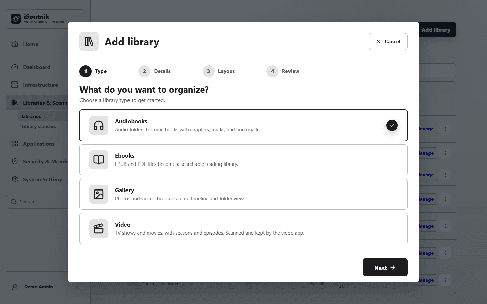
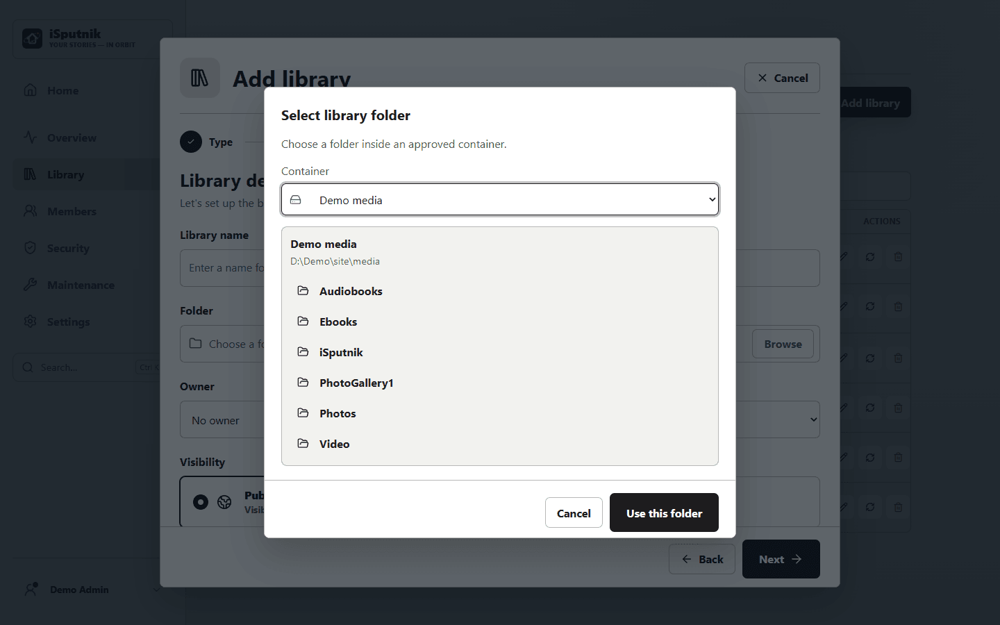
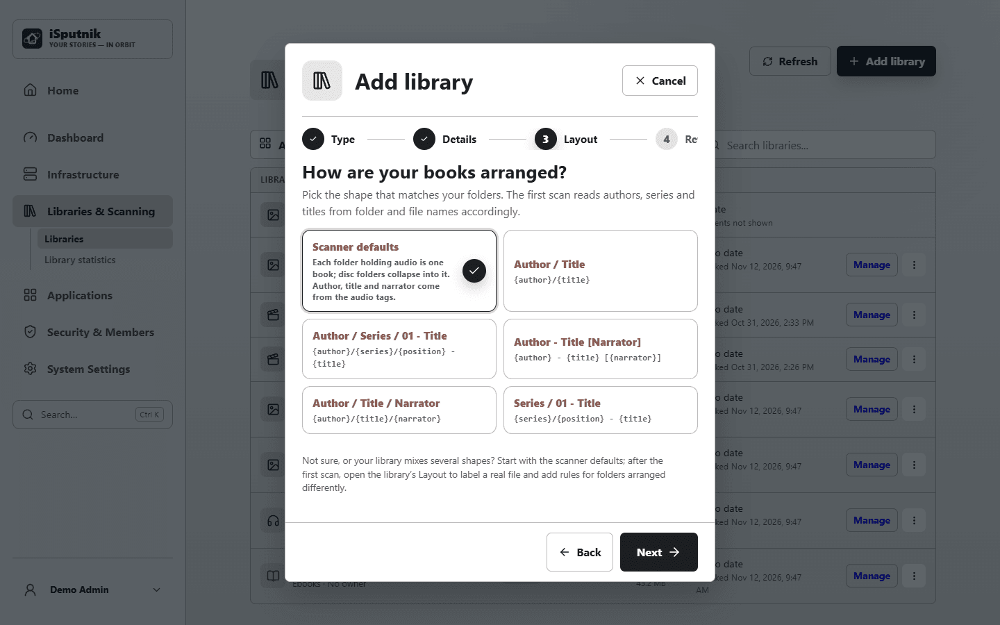
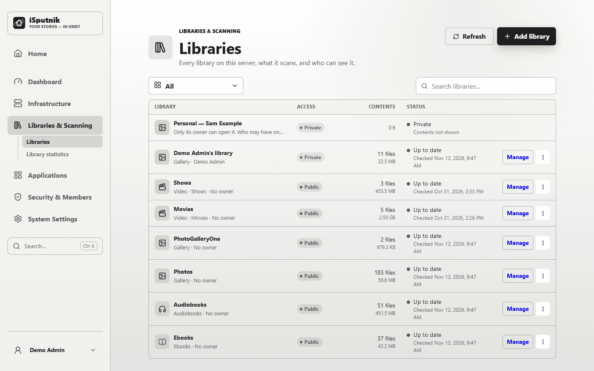

# Setting up libraries

A **library** points the app at one folder and says what kind of media is in it.
You can have as many as you like — one per drive, one per person, one per
collection — and they can be shared with everyone or kept to yourself.

Libraries live in **Control panel → Libraries & Scanning → Libraries**. If **Add library** is greyed
out, [storage](storage.md) isn't set up yet.

## The wizard

**Add library** walks through three steps, four for a book library.

### 1. What kind of media?

| Type | Use it for | How files become items |
|---|---|---|
| **Audiobooks** | Spoken-word audio | A *folder* of audio files becomes one book, its files becoming tracks/chapters |
| **eBooks** | EPUB and PDF | Each file becomes one book; the same title in several formats groups together |
| **Gallery** | Photos and videos | Each file becomes its own item |

The type can't be changed afterwards — the way files are interpreted is
fundamentally different. If you get it wrong, delete the library and add it
again; your files are untouched either way.

### 2. Details

Give it a name, then choose the folder with **Browse**. You can only pick
inside an approved container, and you can go into subfolders:

**Visibility** decides who gets it:

| | Who can see it |
|---|---|
| **Public** | Everyone with an account on your server |
| **Private** | Only you, plus anyone you invite to the library afterwards |

**Owner** is optional. Leaving it as *No owner (system library)* makes it a
shared household library; naming an owner makes it theirs to manage.

**Advanced options** covers file formats, upload rules and how metadata is read.
The defaults suit most people — you can change all of it later from the
library's **Edit** window.

### 3. Layout (audiobooks and ebooks)

**How are your books arranged?** Pick the shape that matches your folders, such
as *Author / Series / 01 - Title*, and the first scan reads authors, series and
titles from folder and file names accordingly. Not sure, or your library mixes
several shapes? Keep **Scanner defaults**; after the first scan, open the
library's **Layout** to label a real file and add rules for folders arranged
differently. The audiobook and ebook guides explain both.

### 4. Review

The last step lists everything back to you — type, folder, visibility, formats,
where metadata comes from — before anything happens. **Add and scan** creates
the library and immediately starts reading the folder.

## The first scan

Scanning runs in the background; you don't have to wait on the page. While it
runs the library shows **Scanning**, and item counts climb as it goes.

What a scan does:

1. Walks the folder for files it recognises.
2. Creates an item for each book, ebook or photo it finds.
3. Reads metadata from the files — titles, authors, chapters, capture dates.
4. Generates covers and previews into your thumbnail folder.

**Only one scan runs at a time** across the whole server, so starting several
just queues them.

Re-scan any time from the library's ⟳ button — after adding files, for
instance. A re-scan picks up what's new and leaves your own edits alone: titles
you corrected, series you arranged, and tags you added are marked as yours and
aren't overwritten.

## Adding files later

Two ways:

- **Copy them into the folder** and re-scan. Best for bulk additions.
- **Upload from the app** if the library allows it — the upload button appears
  on the library page. Uploads land in the library folder like any other file.

## Editing and removing

Cards across the top count your libraries, their files and size, and say what is
scanning, when the next scheduled scan runs and what needs a look; **Rescan all**,
the scan schedules and the storage containers are beside them. A button per type
(and **Personal**) filters the table below, twenty libraries a page.

Each library row shows who can open it, how many files it holds and how big it is,
and its **Status** — up to date, scanning (with a link to follow it in Tasks), or what
went wrong. Its **⋯** — or a right-click anywhere on the row — opens one menu:

- **Rescan** — re-read the folder.
- **Delete library** — removes the library *from the app*. **Your files stay on
  disk.** Only the catalogue entry, and the covers generated from it, go away.
- **Edit** (or a click on the row) — one window for everything about the library.
  The numbered steps across its top jump to its sections, and the one you are reading
  stays lit; **Rescan** is beside its title, **Save changes** and **Delete library**
  at its foot. The sections:
  - **Summary** — its files, size, status and when it was last scanned.
  - **Name and access** — its name, owner, whether everyone may open it and what they
    may do, and under them its **Members and groups**: who else may open it and with
    what role. Members and groups save as you change them.
  - **Files and scanning** — its folder, whether this app manages the files (Mode),
    where details come from, formats and upload rules; **Layout** for a book library
    and **Face recognition** and **Phone backups** for a shared photo library. Phone
    backups ticks members' phones whose photos are already in it, so switching on
    [phone backup](phone-backup-linking.md) doesn't store them twice. A video
    library has its folder and language here.
  - **Organizing** — the shared sets it is sorted by (Book categories, Tags or Video genres).
  - **About** — your role, what you can do, and when it was made and changed.

## Next

- [Audiobooks](library-audiobooks.md)
- [Ebooks](library-ebooks.md)
- [Gallery](library-gallery.md)
