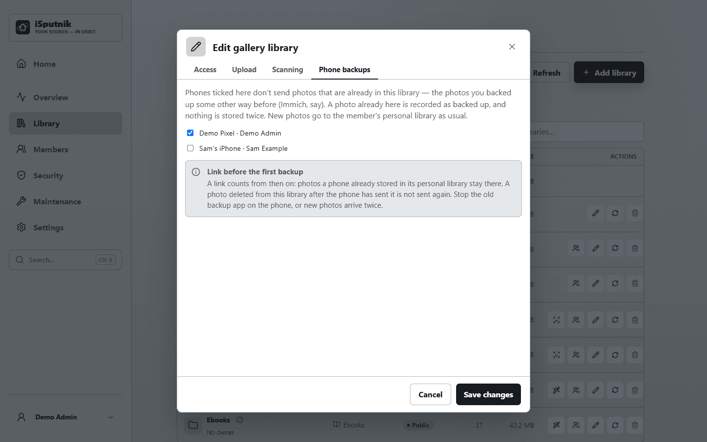

# Linking a phone to a library

Some phones were backed up long before PhotoSync: another app (Immich, say) already copies
their photos into a folder the family reads as a photo library. Switched on as it is, the first
PhotoSync backup would send every one of those photos again and store a second copy in My
library. **Linking** the phone to that library stops it: a photo that is already there counts as
backed up, and only photos that aren't there yet go to My library.

### Who does what

| | Member | Admin |
| --- | --- | --- |
| Adds the phone on Profile › My library | Yes | |
| Links it to a family library | | Yes |
| Stops the old app's backup | Yes | |
| Switches PhotoSync on | Yes | |

### What happens when…

- **A photo is already in the linked library.** It counts as backed up and is not stored again.
- **Someone deletes it from that library afterwards.** It is not sent again, and not brought back.
- **It was deleted there before the first backup.** Nothing remembers it, so it goes to My library.
- **The member loses access to the library.** The link stops counting.

> [!IMPORTANT]
> **Link before the first backup.** A link counts from then on: what was already stored in My
> library stays there.

## For the member

1. Add the phone on **Profile › My library › Phones** as usual (see
   [Backing up your phone](phone-backup.md#adding-a-phone)), but don't start the first backup
   yet.
2. Ask your administrator to link it to the library that already holds your photos.
3. Once linked, the phone's card says so: *Photos already in Family Photos aren't stored again.*
4. **Stop the old app's backup on the phone**, then switch PhotoSync on. Otherwise every new
   photo arrives twice: once in My library, once through the old app.

A photo you delete from the family library *before* the first backup is still on your phone and
nothing remembers it, so it is backed up into My library: delete it on the phone too, or tidy up
after the first backup. A photo edited on the phone is new to the server and is backed up again.

## Linking a phone
<!-- admin -->

1. Open **Library › Libraries** in the control panel and **Manage** the library that already
   holds the member's photos.
2. **Edit** its **Phone backups**. It lists the phones of the members who can open this library.
3. Tick the member's phone and save.

Only members who can open that library are offered, and a link stops counting if they lose
access: the tab says so beside the phone. Each phone is linked on its own: a phone set up again
(a new entry on Profile › My library) starts unlinked, so tick it again.

**Library › Device Sync** shows, under each phone, the libraries it is linked to.
