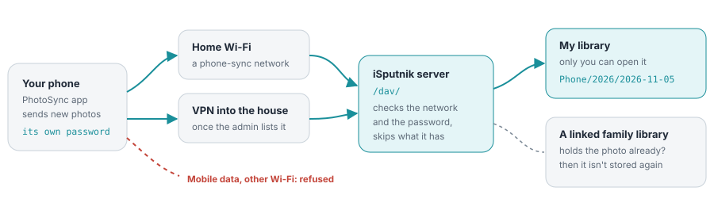
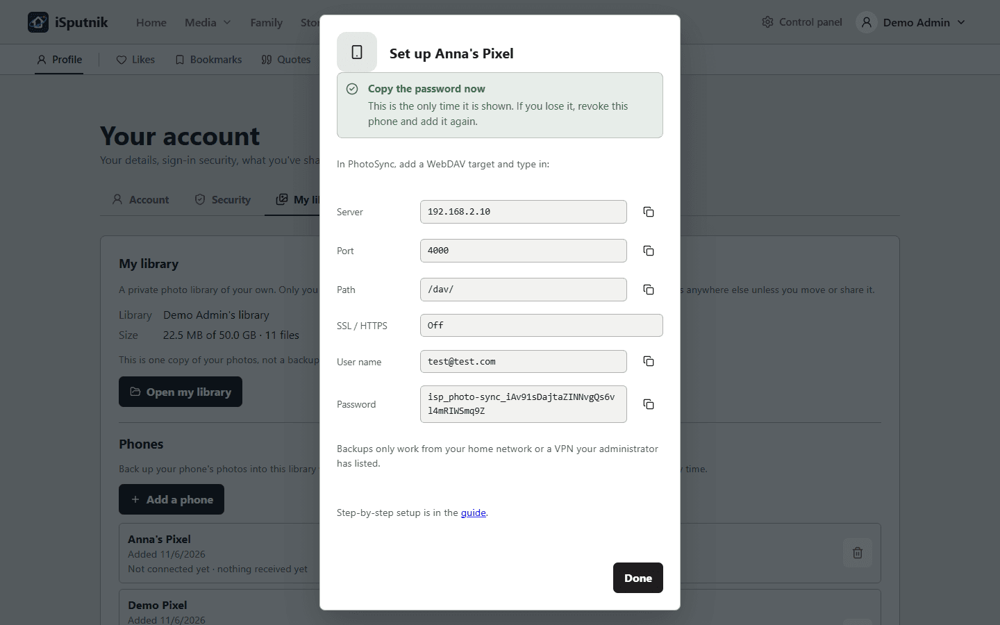
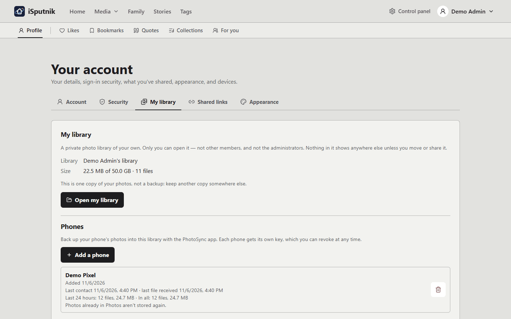

# Backing up your phone

Your phone can copy every new photo and video into **your own private library** on iSputnik,
at full quality, while it is at home on the Wi-Fi. It uses the **PhotoSync** app (Android and
iPhone), which talks to iSputnik directly: nothing goes through anyone's cloud, and nothing
comes back the other way. A photo you delete on the phone stays at home.

### Who sees what

| | You | Family | Admins |
| --- | --- | --- | --- |
| Photos and videos in My library | Yes | No | No |
| How full the library is | Yes | No | Yes |
| Your phones and their last contact | Yes | No | Yes |
| Photos you move to a family library | Yes | Yes | Yes |

### What happens when…

- **You delete a photo on the phone.** Nothing at home: backup only ever adds.
- **You lose the phone.** Revoke it on the Phones list. It stops at once; what it sent stays.
- **You send an album again.** The photos travel again, but none is stored twice.
- **You edit a photo on the phone.** It is new to the server, so it is backed up again.

> [!NOTE]
> **What you need.** **PhotoSync** from the Play Store or the App Store: a paid app; on an
> iPhone, automatic backups need its Premium plan, and keeping HEIC photos as they are needs at
> least Pro. And the phone on a network your administrator listed for phone backups: your home
> Wi-Fi, or a VPN into the house. Backups never go over the open internet.

> [!WARNING]
> **One copy, not a backup.** Your library lives on the server's disks. If they fail, it goes
> with them. Keep another copy somewhere else.

## Turning on My library

1. Open **Profile › My library**.
2. Press **Turn on my library**. A library named after you is made, empty.

If the page says personal libraries are not available, your administrator hasn't allowed them
yet (or not for you): ask them. More about the library itself is in
[Your account](your-account.md#my-library).

## Adding a phone

1. On **Profile › My library**, under **Phones**, press **Add a phone**.
2. Give it a name you will recognise ("Anna's Pixel"). Its photos are filed in a folder of
   that name.
3. The next screen shows what to type into PhotoSync: **server**, **port**, **path** (`/dav/`),
   **SSL**, your **user name** and a **password** made for this phone alone. Each has a copy
   button.

   

> [!IMPORTANT]
> **The password is shown only this once.** Leave the screen open until PhotoSync is set up. If
> you lose it, revoke the phone and add it again: it costs nothing.

The card watches for the phone while it is open: it says **Waiting for the phone** until
PhotoSync signs in with these details, then **Connected**, and **First photo received** once
the first one lands. If the phone is refused, the card says why.

If the screen says the server address isn't set yet, your administrator still has to fill it
in; keep the password and ask them for the address. If **Phones** says phone backup is
unavailable, no network has been listed for phone backups yet.

## Setting up PhotoSync

PhotoSync calls iSputnik a **WebDAV** target. The menu names below are PhotoSync's and can move
a little between versions.

### On Android

1. Open PhotoSync, then **Settings › Configure › WebDAV**, and add a new target.
2. Type in what the Add a phone screen showed:
   - **Server**: the address, without `http://` (for example `192.168.2.10`)
   - **Port**: for example `4000`
   - **Path**: `/dav/`
   - **SSL**: off, unless the screen said on
   - **Login / user name**: your user name (your sign-in email)
   - **Password**: the phone's password
3. Save. To try it, select a few photos, press the red transfer button and choose the WebDAV
   target. They appear in your library within moments.

### On iPhone

1. Open PhotoSync, then **Settings › Configure › WebDAV**, and add a new target.
2. Type in the same details as above: server, port, path `/dav/`, SSL, user name, password.
3. Save, then send a few photos by hand to try it.

The iPhone steps follow PhotoSync's own instructions and have not been tried on an iPhone
yet; if something looks different on your phone, tell your administrator.

## Backing up automatically

PhotoSync's **Autotransfer** sends new photos on its own. Point it at the WebDAV target, choose
the albums to back up (usually Camera, and Screenshots or WhatsApp if you want those), and
**restrict it to Wi-Fi**, so it never tries from mobile data, where the server can't be reached
anyway. PhotoSync remembers what it already sent and asks the server before sending, so
Autotransfer only ever sends new photos.

### On Android

In **Settings › Autotransfer**, choose the WebDAV target and set the trigger to **Instant**: a
new photo goes a minute or two after you take it, whenever the phone is on the home Wi-Fi.

**Samsung phones** (and some others, such as Xiaomi) hold background apps back to save battery,
and a photo can then wait until you next open PhotoSync. To stop that:

1. **Settings › Apps › PhotoSync › Battery**: choose **Unrestricted**.
2. **Settings › Battery › Background usage limits**: make sure PhotoSync is **not** in
   *Sleeping apps* or *Deep sleeping apps*.

### On iPhone

An iPhone does not let any app run whenever it likes, so Autotransfer only starts when
something wakes it. PhotoSync offers three ways:

- **When charging**: iOS picks the moment and may put it off.
- **Arriving at a location**: needs location access set to *Always*, and fires when you arrive
  home from at least 200 m away.
- **A Shortcuts automation**: for example *when connected to the home Wi-Fi*, or *every night
  at 02:00 while charging*, running PhotoSync's Autotransfer action.

Each background run gets only about **three minutes**, so it carries the day's handful of new
photos, not a whole camera roll or a long video. And if you swipe PhotoSync away in the app
switcher, iOS stops waking it: leave it there.

## The first backup

The first backup sends everything, which can be thousands of photos. Do it **with PhotoSync
open**:

1. Plug the phone in and keep it on the home Wi-Fi.
2. Open PhotoSync and transfer all the albums by hand.
3. Leave it overnight with the screen on.

On an iPhone this is the only way it finishes; on Android it is simply quicker. After that,
Autotransfer keeps up. If the transfer stops part-way, start it again: nothing half-sent is
ever kept, and what arrived is not stored twice.

## Photos you already have

If your phone's photos already reach the server some other way (another backup app such as
Immich, whose folder the family reads as a photo library), the first backup would send every one
of them again. Ask your administrator to **link your phone** to that library **before** you
switch PhotoSync on: then a photo that is already there counts as backed up and is not stored
twice. How it works, and what deleting does, is in
[Linking a phone to a library](phone-backup-linking.md).

## Is it working?

Each phone on **Profile › My library › Phones** shows how it is doing:

- **Last contact**: when the phone last spoke to the server, and when the last file arrived.
- **Last 24 hours** and **In all**: how many files it sent, and how big.
- **A problem**, if there was one, and when. It shows as a notice until the phone backs up
  again; after that it stays as a line saying it was earlier.
- **No contact for N days**, when the phone hasn't been in touch for a week. Open PhotoSync on
  it: it may be off the home Wi-Fi, swiped away (iPhone), or held back by battery settings
  (Android, see above).
- **Your library is 90% full**, when your library is close to the size limit your administrator
  set. Phones are refused once it is full, so make room before then.

The problems you may see:

| Problem | What to do |
| --- | --- |
| **Refused: not from a phone-backup network** (with an address) | The phone tried from somewhere not listed: mobile data, a friend's Wi-Fi, a VPN the administrator hasn't added. Back up at home, or ask the administrator to list your VPN. |
| **File type not allowed: .dng** | RAW photos (and other types the library doesn't take) are turned away. Switch RAW off in the camera, or leave those out of Autotransfer. The other photos still go. |
| **Your library has reached its size limit** | Your administrator set a limit. Move photos into a family library, delete some, or ask for more room. |
| **The server's disk is full** | Tell your administrator. Nothing is lost; the phone sends again once there is room. |
| **An upload stopped part-way** / **arrived damaged** | Usually the Wi-Fi dropped. PhotoSync sends the photo again next time; nothing broken is kept. |

## Away from home

Backups away from home only work through a **VPN into the house** (UniFi, WireGuard, Tailscale
and the like), and only once your administrator has added the VPN's addresses to the
phone-backup networks.

1. Turn the VPN on.
2. Send from PhotoSync by hand. If Autotransfer is set to *Wi-Fi only*, it waits until you are
   home.

Without the VPN the phone is refused (the Phones list says from which address) and simply
catches up when you are home again.

## Good to know

- **Where the photos go.** Each phone has a folder of its own in your library, named after it,
  and inside it a folder per day the photo was taken (`Anna's Pixel/2026/2026-11-05`). The
  date comes from the photo itself, or its name, or what the phone says.
- **Live Photos** arrive as two files, a photo and a short video with the same name, and
  become **one photo** with a *LIVE* mark. To see the motion, open the photo and press
  **LIVE**, hold the photo on a phone, or hover it with the mouse on a computer. Keep both
  files together: the pair is recognised by name. (This works in every photo library, not only
  your own.)
- **A lost or replaced phone**: **Revoke** it on the Phones list. It stops at once, and what it
  sent stays. A new phone is added as a new phone, with its own folder.
- **Setting it up for the household** (personal libraries, networks, the address phones use)
  is in [Setting up phone backups](phone-sync-setup.md).
