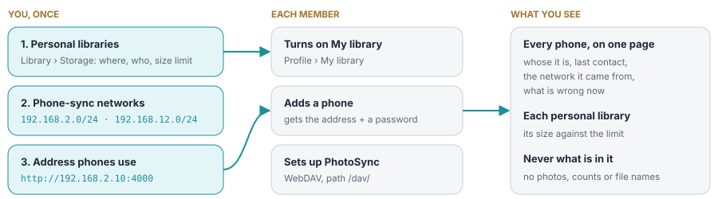
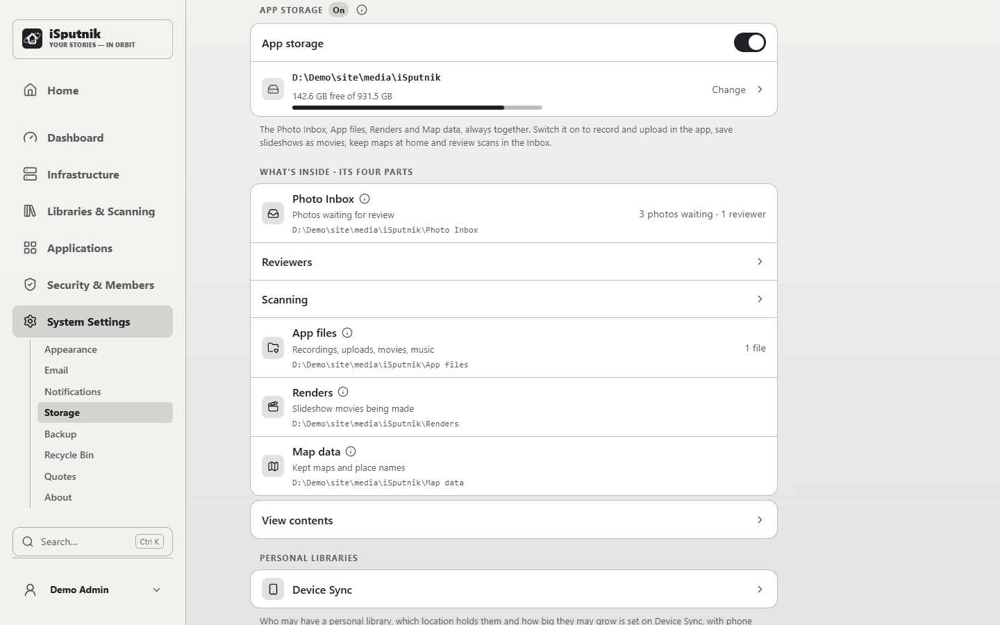
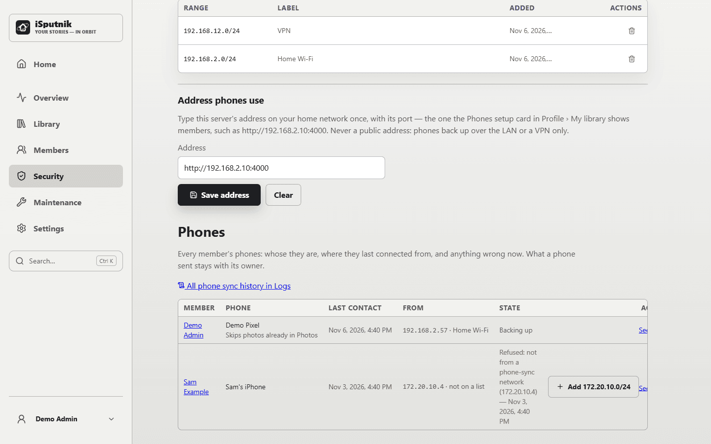

# Setting up phone backups

Members back their phones up into a personal library of their own with the PhotoSync app (see
[Backing up your phone](phone-backup.md)). Nothing works until you allow it, on purpose: three
settings, once per install. After that each member turns on their own library and adds their
own phones, and you see how each phone is doing, never what it sent.

### What you see of a member's backups

| | You see it |
| --- | --- |
| Their phones, last contact, the network | Yes |
| A problem with the phone or the server | Yes |
| How full their library is | Yes |
| The photos, how many, their names | No |

### Rules that always hold

- **Phones only back up from listed networks.** Never over the open internet.
- **Only the member opens their library.** Not other members, not administrators.
- **Deleting on a phone never deletes at home.** Backup only adds.
- **It is one copy, not a backup.** The server's own backups cover it like any library.

## Allowing personal libraries

1. Open **Applications › Gallery › Device Sync** in the control panel and, under **Personal libraries**,
   open **Members may have one**.
2. Turn them on, choose the folder they are made in, and who may have one.
3. Set a **size limit** if you want one. Members see how full they are; phones are refused once
   a library is full.

The card also totals them: how many there are, how much they hold, and how many phones back up
into each. More in [Storage](storage.md#personal-libraries).

## Listing the networks

Phones are refused unless they come from a **phone-backup network**.

1. Open **Applications › Gallery › Device Sync**.
2. Under **Where phones may back up from**, press **Add network** and add your home network, for
   example `192.168.2.0/24`. **Copy trusted networks**, on the same page, is a starting point.
3. Open **Address phones use** and type the address phones on that network reach the server at,
   such as `http://192.168.2.10:4000`. Members are shown it when they add a phone. Once both are
   set, the line at the top of the page says phone backup is on.

The list is separate from Trusted networks, so adding a VPN range for phones does not relax
sign-in for it.

> [!CAUTION]
> **Never publish `/dav` through a public proxy or tunnel.** Phone backup is for the home
> network and VPNs into it.

## Backups away from home

For backups away from home, add the **VPN's own range**: the addresses phones get on the VPN,
not your home network's, with its size. `192.168.12.0/24`, not `192.168.12.0`, which is one
address.

- On a **UniFi** gateway it is under *UniFi Network › Settings › VPN › VPN Server*.
- For **WireGuard** it is often `10.6.0.0/24`; for **Tailscale** `100.64.0.0/10`.

The VPN must route to the server without hiding the phone's address (UniFi's VPN server does).
A phone that tries from an unlisted network shows on **Device Sync** as *Needs attention*; its
page offers **Allow 192.168.12.0/24 for phone backup** (the /24 it came from).

## Watching the phones

**Applications › Gallery › Device Sync** lists every member's phones, with one word each for how it
stands: backed up when, not seen for some days, a library nearly full, or *Needs attention*. A
phone opens its own page: its member, last contact, the address and network it last came from,
what is wrong now, the libraries it is linked to, **This phone's history** in the logs, and
**Remove this phone**.

- **A member's page › Account** has a *Personal library and phones* card: the library's size
  (with a warning near the limit), each phone with when it was added and last made contact, and
  a problem when it is about the phone or the server. You can **Revoke** a phone there.
- **Infrastructure › Logs**, filtered to the *photo_sync* event, is the history: phones added and
  revoked, a phone's first contact and each move to another network (home Wi-Fi to the VPN),
  refusals (an unlisted network, a revoked or unknown password), a full disk or library, and
  "backing up again" afterwards. At most once an hour per phone and problem, never a file name.

## Photos already on the server

If a member's phone was backed up some other way into a shared photo library (Immich, say),
link the phone to that library **before** they switch PhotoSync on, so nothing is stored twice.
See [Linking a phone to a library](phone-backup-linking.md).
