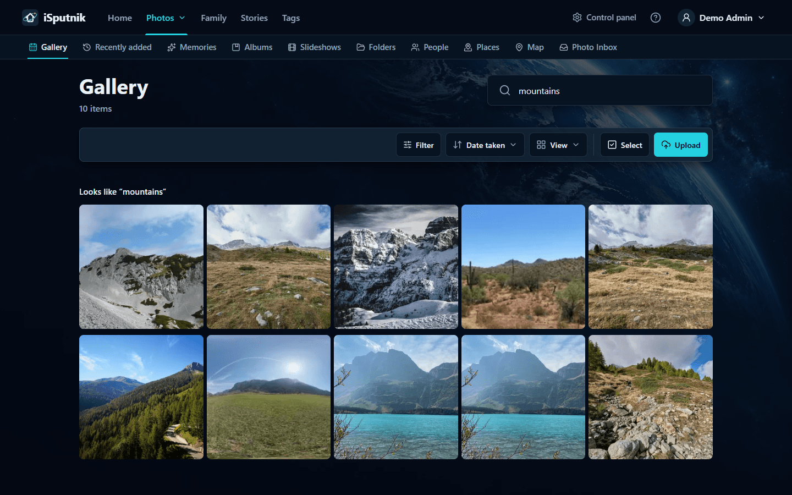
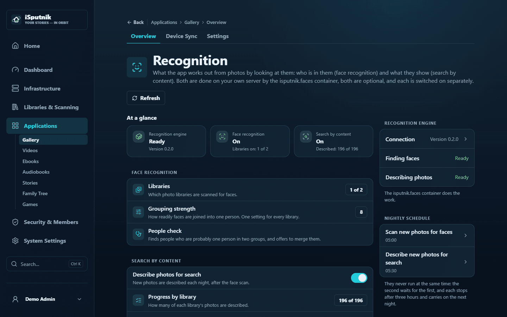

# Finding photos by what they show

**Gallery → search box** · switched on under **Control panel → Applications → Gallery → Recognition**

Most photos carry no words at all. Nobody typed "hockey" on the pictures from
the rink, or "birthday cake" on the ones from the party, so a search for those
words used to find nothing unless a folder happened to be named that way.

With **search by content** switched on, the Gallery's search also looks at the
pictures themselves. Type what you are looking for and the photos that *look*
like it come back, with nobody having tagged anything.

## Searching

Type a word or a short phrase into the search box on the Gallery's main page:
`mountains`, `a cat`, `food on a table`, `people at a wedding`. The results come in
two parts:

- **Looks like "…"**: the photos that look like what you typed, best match
  first. Twelve are shown; **Show all** opens the rest.
- **Matched by name**: what the search has always found, in date order: photos
  whose title, caption, folder, the writing on the back of a print, or a named
  person contains the words.

A photo can appear in both. If neither part has anything, the page says nothing
matches.

A few things worth knowing:

- **Describe the picture, not the occasion.** `snow`, `a beach`, `a child on a
  bicycle` work well. A name, a year or "Grandma's 80th" is not something a
  picture shows; use People, the date filter or an album for those.
- **English only, for now.** Words in other languages mostly find nothing.
- **It ranks, it does not know.** The first results are usually right and the
  last ones are often only similar. A search for something you have no photos of
  may still return a few that share a colour or a setting.
- **Filters still apply.** Whatever is set under **Filter** (libraries, people,
  years, tags, photos or videos) narrows these results too.
- **You only ever find what you could already open.** Search looks in the
  libraries you have access to and nowhere else.
- **Photos only.** Videos are found by name, as before.

It works on the Gallery's main page (the Timeline). Folders, People, Albums and
the other views keep their own searches.

## Switching it on (administrators)

It is off until you switch it on, and it needs the **Faces** app: the same
container that finds faces also works out what a photo shows, from version 0.2.0
([Adding the games, video and faces apps](apps.md#faces)). You do not need face
recognition itself switched on.

Open **Control panel → Applications → Gallery → Recognition**. The page holds
both things the app works out from photos, face recognition and this; under
**Search by content**, turn on **Describe photos for search**.

That starts the first pass straight away. There is nothing to rescan: each photo
is described from the thumbnail the Gallery already made, once, and the result
is kept. **Progress by library** shows how far each library has got, and search
works on whatever is described so far.

- **How long it takes.** A fraction of a second to a second per photo, depending
  on the server. A library of tens of thousands of photos takes hours; the first
  pass runs until it is done.
- **New photos** are described each night by the scheduled job **Describe new
  photos for search** (05:30 by default, after the face scan). It is a job of
  its own under **Infrastructure → Scheduled jobs**, where you can move or
  disable it. It runs for at most three hours a night and carries on the next
  night, and it never runs at the same time as a library scan or a face scan.
- **Which libraries.** One switch covers every gallery library, personal
  libraries included; their photos are still only found by their owner. The
  Photo Inbox is never described: photos waiting there are not part of the
  collection yet.
- **Nothing leaves your server.** The photos are described by your own Faces
  container. What people type into search is not logged.
- **Storage.** Under a kilobyte per photo, in the database: about 80 MB for
  100,000 photos.

Two more actions in that section:

- **Scan photos** opens a choice: **Only what is new** describes the photos not
  done yet without waiting for the night, and **Everything again** describes
  every photo afresh. Nothing is thrown away until each photo is done again, so
  search keeps working meanwhile. You should not normally need either.
- **Delete search data** appears once the switch is off. It removes what was
  worked out about the photos, and nothing else: photos, faces, people and tags
  are untouched. Switching back on describes the photos again.

If the page says the recognition engine is not available, the Faces container
is not paired, is stopped, or is older than 0.2.0. Search by name is unaffected
in every case: the "Looks like" section is simply not there until the engine is
back.
