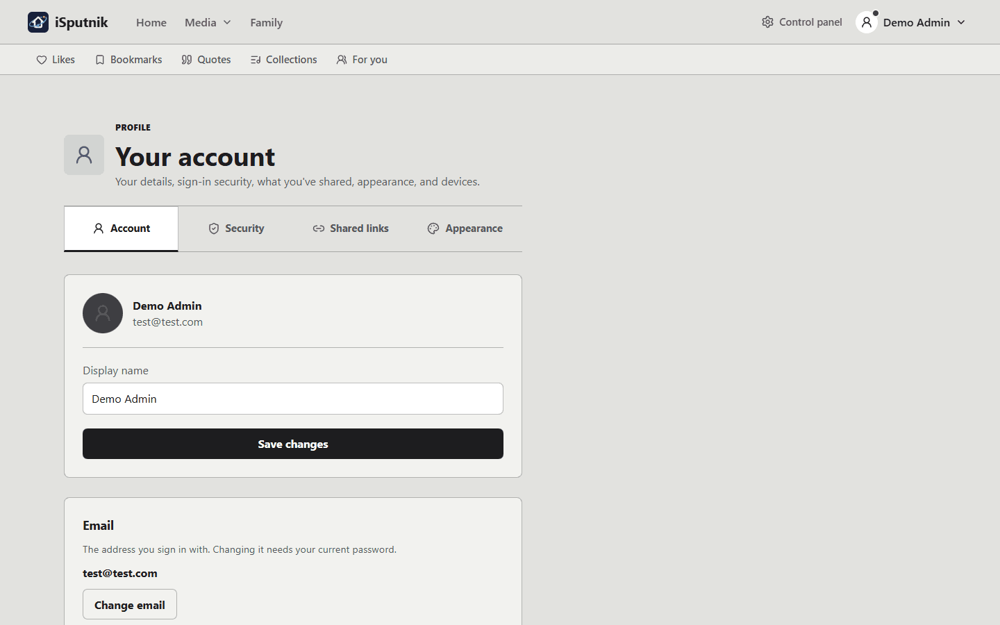
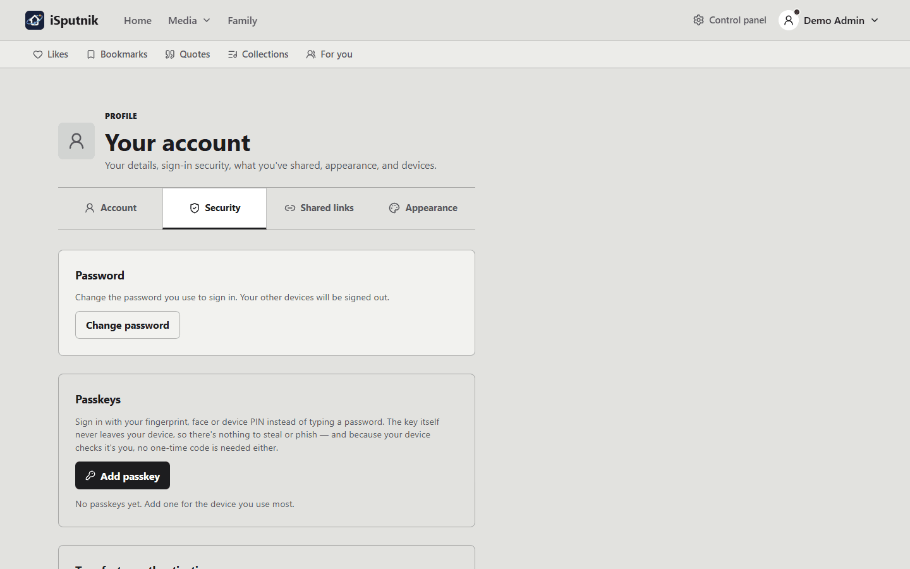
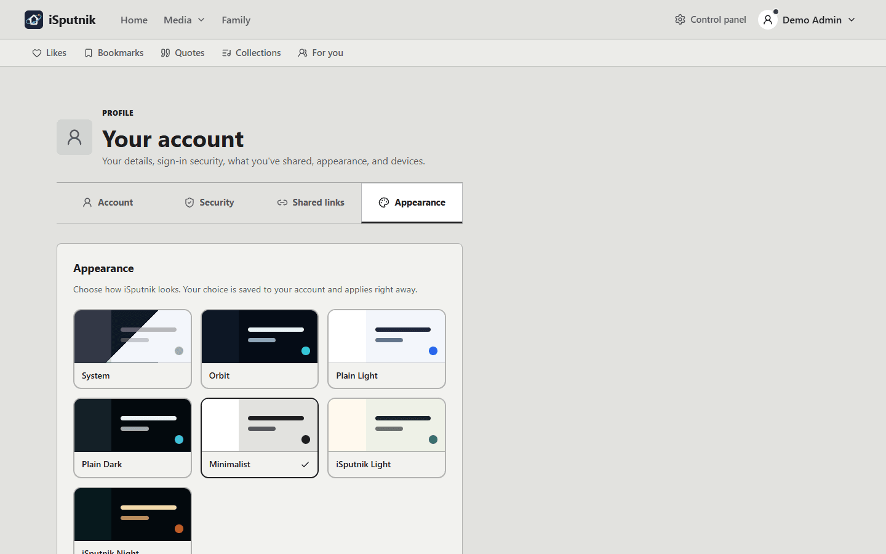

# Your account

Everything that belongs to you rather than to the server: your name and sign-in
details, how the app looks, where your saved things live, and the address your
e-reader receives books at.

All of it hangs off the **menu with your name on it** (bottom-left on a computer,
the **Profile** tab in the installed app). That menu has two halves: **Profile**,
which is your account settings, and the list of things you've saved.

## Profile — your account settings

**Profile** opens a page with five tabs: Account, Security, My library, Shared
links and Appearance. Each has its own address, so you can
bookmark the one you use and the back button returns you to it rather than
leaving the page.

### Account

| | |
|---|---|
| **Display name** | What other people in your household see beside anything you share |
| **Sign-in email** | The address you log in with |
| **Language** | The language the app speaks to you in. Applied the moment you pick it, and saved to your account |
| **Send to e-reader** | The address your Kindle or Kobo receives books at ([see below](#send-to-e-reader)) |
| **Install the app** | Add iSputnik to your phone's home screen. Installed, it gets a bottom nav and an offline **Downloads** screen, so books you download stay readable and listenable with no connection |

Changing the email needs your current password, and both addresses are told about
it afterwards — the old one included, because if the change wasn't you, the old
inbox is the only place that news can still reach you.

### Security

- **Change password** — needs the current one.
- **Two-factor authentication** — a one-time code after your password, from an
  authenticator app or by email. This is the single biggest thing you can do for
  your account; it has [its own guide](two-factor-authentication.md).
- **Devices** — everywhere your account is signed in, linked screens first. Rename
  one, or remove it and it is signed out on its next request
  ([Link a device](link-a-device.md)).
- **Reader access** — tokens that let a reading app open your ebooks
  ([see below](#reader-access)).

Turning two-factor on or off, changing your password, and changing your email all
send you a note. If one arrives that you didn't cause, change your password.

### Shared links

Every guest link you have made, in one list — for a book, a photo, an album, or a
selection of photos. Each row shows what it points at, when you shared it, and
when it expires; expired ones are listed separately and greyed, because knowing a
link *stopped* working is often the thing you came to check.

**Revoke** cuts a link off immediately. Nothing is deleted, and anyone you shared
with by account keeps their access — that is a different kind of sharing, managed
per item on the **People** tab of the Share box.

The link addresses themselves are not here, and cannot be. Only a fingerprint of
each link is stored, never the link itself, so it can be shown to you exactly
once — when you create it. If you have lost a link, revoke it and make a new one.
The upside is that someone who steals a copy of the database still cannot open
anything you have shared.

Only your own links appear, and this is the only place to see them all; an
administrator cannot list yours from here either.

### Appearance

Eight choices, saved to your account, applied the moment you pick one — so the same
theme follows you to your phone.

| | |
|---|---|
| **System** | Follows your device's light/dark setting |
| **iSputnik Night** | The house dark theme — dark teal, warm text |
| **iSputnik Light** | The house light theme — soft paper and green |
| **Orbit** | Deep navy with a teal accent and Earth from orbit behind Home |
| **Thanksgiving** | Warm autumn browns with an amber accent, serif headings and a lake at sunset behind Home |
| **Plain Dark** | Deep blue-black with a cyan accent, no scene artwork |
| **Plain Light** | Neutral light greys, if you'd rather the app got out of the way |
| **Minimalist** | Platinum grey and black ink, like a certain beige computer |

**Layout**, below the themes, brings back the classic sidebar on the computer you are
using, if you would rather have it for now. The classic layout will be retired in a
later release. Phones have one layout, so they don't show this.

## My library

**Profile › My library** is a private photo library of your own. Only you can open it — not
the other members of your household, and not the administrators. Its photos don't show up on
anyone else's Home page, timeline, map, memories or People, and they are never shared through a
person someone was given access to.

Your administrator decides whether personal libraries are available and to whom. If they are
not, the tab says why. If they are:

1. Press **Turn on my library**. A library named after you is made, empty.
2. Press **Open my library** to go to it in the Gallery, and upload photos there as you would
   in any library.
3. The tab shows how much it holds, and the size limit if your administrator set one. When it
   is full, nothing more can be added until you move or delete something.

Photos leave it only when you take them out: move a folder into a family library, add photos to
an album and share it, or download them. Face recognition does not run in a personal library.

If an administrator made an existing library yours — for example, photos brought over from your
phone — the tab says so.

### Phones

Under your library, **Phones** is where you let a phone back up its photos into it, with the
PhotoSync app. Your administrator first has to say which networks phones may back up from
(your home Wi-Fi, a VPN); until then the section says phone backup is unavailable.

1. Press **Add a phone** and give it a name ("My Galaxy").
2. The next screen shows what to type into PhotoSync's WebDAV target: server, port, path
   (`/dav/`), SSL, your user name, and a password made for this phone alone. If your
   administrator hasn't set the server address yet, the screen says so — ask them for it. **The
   password is shown only this once** — copy it now.
3. The phone appears in the list, with when it last connected.

Each phone's photos go into a folder of their own in your library, named after the phone, and
then by the day they were taken (`My Galaxy/2026/2026-11-05`). A photo the phone already sent is
not sent again, and one already in your library is not stored twice. Deleting a photo on the
phone never deletes it here. Files your library doesn't take (RAW photos such as `.dng`) are
turned away.

Backups only work from the networks your administrator listed, never over the internet. If a
phone is lost or replaced, **Revoke** it: it stops at once, and the photos it already sent stay.

Each phone in the list shows how its backup is going: last contact, the last file received,
what arrived in the last 24 hours and in all, and the last problem ("File type not allowed:
.dng", "Refused: not from a phone-backup network") until the phone backs up again. A phone out of
touch for a week says so, and a library close to its size limit warns here and on My library
before phones are refused. Setting up PhotoSync step by step, automatic
backups and battery settings are in [Backing up your phone](phone-backup.md).

> Your personal library is one copy of your photos, not a backup. Keep another copy somewhere
> else.

## Reader access

Read your ebooks in a reading app — KOReader, Moon+ Reader, Thorium — instead of
the browser. The app browses the library over OPDS, a catalog format most reading
apps understand, and downloads what you open.

1. **Create token**, and name it after the device ("Kobo Clara").
2. Copy the **catalog link** into your reading app's OPDS catalogs, or scan the QR
   code with a phone or tablet. An app that asks for a username and password
   instead gets them under **Prefer a username & password?**
3. That's the only time the token is shown. If you lose it, remove it and make a
   new one.

Each token is yours, reads only what you can already see, and can't change
anything. Removing one cuts that device off at its next catalog refresh and leaves
your other devices alone. Every member can make their own, at the bottom of Profile →
Security; before 4.15 this was in the control panel, where only administrators
could reach it.

## Send to e-reader

Set the address your Kindle or Kobo receives documents at (something like
`you@kindle.com`, from your device's settings), and every ebook gets a **Send to
e-reader** button that mails the EPUB or PDF straight to it.

Three things have to line up, and it fails quietly if any is missing:

1. **Your device address** — Profile → Account.
2. **The server can send email** — an administrator sets this up
   ([guide](email.md)). Without it the button tells you so.
3. **The server's address is on your device's approved-senders list** — Amazon and
   Kobo drop mail from anyone you haven't approved, without telling you. Add the
   **From address** from the server's email settings (ask your administrator) to
   the approved list in your Amazon or Kobo account.

If a book never arrives, number 3 is almost always why.

## The things you've saved

The rest of that menu is your own collection of pointers into the libraries.
Nothing here copies or moves a file — remove any of it and the original is
untouched.

| | What it holds | How things get there |
|---|---|---|
| **Shared with me** | Books, photos and albums other people have shared with your account | Someone else shares them; they appear here |
| **Likes** | Anything worth finding again — audiobooks, ebooks and photos together | The heart on a book's page, or on a photo |
| **Bookmarks** | Places inside a book: a moment in an audiobook, a page in an ebook | The bookmark button while listening or reading |
| **Quotes** | Passages worth keeping, with the book and page they came from | Highlight text in the reader, or **Add quote** on any book |
| **Collections** | Lists you make yourself, which can mix audiobooks, ebooks and photos in one list | **Add to collection** from any item |
| **Downloads** | Books kept on this device for offline use *(installed app only)* | The download button on a book |

**Likes vs Collections** is the usual question. Likes is one flat list —
one tap, no thinking. A collection is a list you name and curate ("Car trips",
"Read with the kids"), and one item can sit in as many as you like.

Bookmarks and quotes both live inside books, but they answer different questions:
a bookmark is *where I was*, a quote is *what it said*.

Your place in a book isn't in any of these lists — it's saved automatically, and
picked up from the **Continue** row on the home screen, on whichever device you
carry on with.

## What only an administrator can do

Not everything about your account is yours to change:

- **Which libraries you can see** — access is granted per library.
- **Resetting your two-factor** if you've lost both your codes and your backup
  codes.
- **Your role** (whether you're an administrator at all).
- **Deactivating an account.**

If you're the only person here, you're the administrator too — those controls are
in the **Control panel**.
